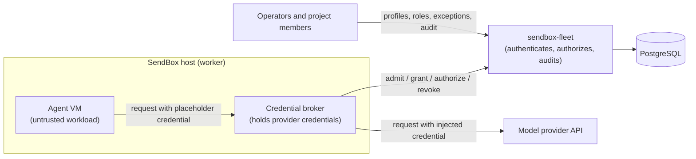

# Architecture

`sendbox-fleet` is the shared governance service for SendBox governed sessions
([mbianchidev/sendbox#87](https://github.com/mbianchidev/sendbox/issues/87)).
It is increment 2 of that issue: the authenticated, multi-user management API
and central authority that increment 1 deliberately left out.

It authenticates every `/v1` caller (service tokens or OpenID Connect),
enforces project-scoped roles, verifies and publishes operator-signed
profiles, admits governed sessions, issues and checks credential grants,
records bounded and expiring exceptions and host-reported request outcomes,
and keeps a hash-chained central audit log whose signed heads can be anchored
outside the database. See [roadmap.md](roadmap.md) for what remains and
[deployment.md](deployment.md) for running it.

## Relationship to SendBox increment 1

Increment 1 lives in the [sendbox](https://github.com/mbianchidev/sendbox)
repository and works on a single host:

- An operator signs a governance profile (the maximum a session may do). The
  host verifies it and binds its digest and revision into the session plan.
- `LocalGrantAuthority` (in `sendbox-governance`) issues, authorizes, renews,
  and revokes credential grants in process.
- The host credential broker holds provider credentials and injects them into
  approved upstream requests. Agents only ever see a placeholder.

Increment 2 moves the *authority* off the host, so several hosts and users
share one set of profiles, roles, grants, exceptions, and audit evidence. The
fleet implements the same `GrantAuthority` semantics over HTTP (both use
`sendbox_governance::evaluate_request`); a SendBox host whose operator
configuration has a `fleet` section uses its remote authority client instead
of the local one. See SendBox's
[shared governance service](https://github.com/mbianchidev/sendbox/blob/main/docs/architecture/governed-sessions.md#shared-governance-service)
for the host side.



## Trust boundaries

1. **Workload to host broker.** The agent VM is untrusted. It never receives
   provider credentials, and it cannot choose the principal, project, session,
   policy revision, or upstream that a request is attributed to. The broker
   builds every `RequestContext` from trusted host state.
2. **Host to fleet.** A SendBox host is an authenticated *worker* principal.
   The fleet never holds provider credentials: credential injection stays in
   the host broker, and the fleet only decides (admission, grants,
   per-request authorization) and records evidence. A
   compromised fleet can therefore authorize misuse but cannot leak provider
   keys; a compromised host is limited to the sessions and grants the fleet
   issued to it.
3. **People to fleet.** Operators and project members are authenticated *user*
   principals. What they may do is decided by project-scoped roles.
4. **Fleet to database.** The database stores identifiers, digests, signed
   profile bytes, and audit evidence. It stores no credentials, tokens,
   authorization headers, or request bodies; there are no columns for them.

## Authentication is separate from authorization

- **Authentication** answers "who is calling". Every `/v1` request passes
  through `auth::require_bearer` *before* routing, so an unauthenticated
  request is rejected with `401` before its body is read. Only
  `Authorization: Bearer <token>` is accepted. Identity headers such as
  `X-Forwarded-User`, `X-Remote-User`, or `X-Sendbox-Principal` are ignored.
  Two kinds of bearer token are accepted:
  - **Service tokens** (`sbf_…`), issued with `sendbox-fleet admin token
    issue` or exchanged at `POST /v1/tokens`. Only their SHA-256 is stored,
    and a token works while it is unexpired (at most 90 days), unrevoked, and
    its principal is not disabled.
  - **Identity-provider JWTs** from an issuer in `FLEET_OIDC_CONFIG`. The
    signature must verify with the issuer's published keys, and `iss`, `aud`,
    `exp`, `nbf`, `iat`, required claims, and `email_verified` (for email
    principals) must pass. The principal is `<prefix>:<claim>`; it must exist,
    be active, and have the issuer's kind, unless the issuer may auto-provision
    it (with no roles). See [deployment](deployment.md#identity-providers).

  A failed token lookup or unreachable key set is `503`, never an implicit
  allow. Repeated failures from one peer address, and too many requests from
  one principal, get `429` with `Retry-After`.
- **Token exchange.** `POST /v1/tokens` turns an identity-provider sign-in
  into a service token for hosts (`sendbox governance login`). Only JWT
  callers may exchange, so a service token cannot mint another. Lifetime
  defaults to `FLEET_TOKEN_TTL_SECONDS` and is capped by
  `FLEET_TOKEN_MAX_TTL_SECONDS`; a principal holds at most 20 live tokens.
- **Authorization** answers "may this caller do this". It combines the caller
  kind (`user` or `worker`), the fleet-wide `operator` flag, project roles,
  the current profile revision, admitted sessions, grants, and exceptions,
  all read from the database.
- **Workload identity fields are never authoritative.** A binding or grant
  principal must equal the authenticated caller; a host cannot claim another
  identity. `local-user:` principals belong to single-host increment 1 and are
  rejected by both the API and the schema.

## Roles

| Who | May |
| --- | --- |
| Operator (fleet-wide, users only) | Publish profiles, raise minimum revisions, create projects with a first owner, manage any project's roles, revoke grants and exceptions, read and verify all audit |
| `owner` | Assign and remove roles (never leaving the project without an owner), approve or reject exceptions, run sessions |
| `admin` | Approve or reject exceptions, revoke grants (`operator_revoked`, `policy_changed`), run sessions |
| `member` | Run governed sessions, request exceptions |
| `viewer` | Read roles, exceptions, and the project's audit events |

Workers never manage roles, profiles, or exceptions. A principal runs
sessions as itself: it needs `member` or higher in the project.

## Request flow

| Step | Endpoint | Checks |
| --- | --- | --- |
| Identify | `GET /v1/whoami` | Returns the authenticated principal, kind, and operator flag |
| Admit a session | `POST /v1/sessions:admit` | Binding principal is the caller; binding names this authority (`FLEET_AUTHORITY_ID`); caller holds `member` or higher; profile reference is the current revision (at or above the minimum, unexpired, digest matches); brokered services exist in the profile; every bound exception is approved, unrevoked, unexpired, for this project and principal (or project-wide), bound to this exact revision, and permitted by it. Records the canonical binding |
| End a session | `POST /v1/sessions/{session}:end` | Session principal only; revokes every live grant with the matching session reason |
| Issue a grant | `POST /v1/grants` | Caller and request match the admitted session's binding exactly; session not ended; service admitted; methods and path prefixes inside the profile service; profile current; bound exceptions still valid. Lease from the profile; hard expiry capped by the profile TTL, profile expiry, the earliest bound exception expiry, and 7 days |
| Authorize a request | `POST /v1/authorize` | `evaluate_request` against shared state, plus: the caller is the grant principal, the session is not ended, bound exceptions are still valid. Every decision is audited with a redacted target |
| Renew a lease | `POST /v1/grants/{grant}:renew` | Grant principal; not revoked or expired; lease not lapsed; session admitted; profile current; exceptions valid. Lease never exceeds the hard expiry or the earliest exception expiry |
| Revoke a grant | `POST /v1/grants/{grant}:revoke` | Session reasons by the grant principal; `operator_revoked` and `policy_changed` by an `admin`, `owner`, or operator. New requests deny at once; the grace window is the profile's `revocation_grace_seconds` (at most 60) |
| Publish a profile | `PUT /v1/profiles/{profile}` | Operator; body is the exact YAML plus the `sendbox.governance-signatures` bundle that `sendbox governance sign` writes; signatures must satisfy `FLEET_PROFILE_TRUST`; revisions only increase |
| Read a profile | `GET /v1/profiles/{profile}[?revision=N]` | Any caller; the current revision is the newest whose `not_before_unix` has passed |
| Raise the minimum | `PUT /v1/profiles/{profile}/minimum-revision` | Operator; minimums only rise; older revisions, and everything bound to them, become stale |
| Create a project | `POST /v1/projects` | Operator; the owner must be an active principal |
| List or change roles | `GET` / `POST /v1/projects/{project}/roles`, `DELETE …/roles/{principal}` | Listing needs any role (or operator); changes need `owner` (or operator); the last owner cannot be removed or demoted |
| Request an exception | `POST /v1/exceptions` | User with `member` or higher; scope is a denial the current revision lists under `exceptions`; optional principal must be a member; expiry in the future, within the profile's `exceptions.max_ttl_seconds` (at most 7 days) and before the profile expires |
| Decide an exception | `POST /v1/exceptions/{id}:approve` / `:reject` | User with `owner` or `admin`, not the requester; approval only while unexpired and its revision is still current |
| Revoke an exception | `POST /v1/exceptions/{id}:revoke` | Requester, `owner`, `admin`, or operator. Sessions admitted with it are denied on their next request or renewal |
| List exceptions | `GET /v1/exceptions?project=…&state=active\|pending\|all`, `GET /v1/exceptions/{id}` | Any role in the project (or operator) |
| Query audit events | `GET /v1/audit/events` | Operators read everything; others must pass a `project` in which they hold a role. Cursor pagination |
| Verify the chain | `GET /v1/audit/verify` | Operator; recomputes every hash and link |
| Signed chain head | `GET /v1/audit/head` | Operator; the current sequence and hash signed with `FLEET_AUDIT_SIGNING_KEY` (`503` without it) |
| Exchange a sign-in | `POST /v1/tokens` | Identity-provider caller only; `ttl_seconds` in 60 to the maximum; returns the token once with `Cache-Control: no-store` |
| List or revoke tokens | `GET /v1/tokens`, `DELETE /v1/tokens/{id}` | Callers see and revoke their own tokens (never the secret); operators may revoke any |
| Report an outcome | `POST /v1/grants/{grant}:outcome` | Grant principal; service must match the grant. Records the redacted method, path, outcome, reason, status, sizes, and duration as `request.outcome`. Outcomes are evidence only and never change a grant or a decision |

Project identifiers contain a slash (`github:owner/repo`), so clients
percent-encode it in paths: `/v1/projects/github:owner%2Frepo/roles`.

## HTTP responses

Errors use RFC 9457 `application/problem+json` with `type: about:blank`, the
standard reason phrase as `title`, and a specific `detail`.

| Status | When |
| --- | --- |
| `400` | Body, path, or query does not match the contract |
| `401` | Missing, malformed, or unaccepted bearer token (with `WWW-Authenticate: Bearer`) |
| `403` | Authenticated, but the role, kind, operator flag, profile, or signer check refuses it |
| `404` / `405` | Unknown resource or path, or unsupported method |
| `409` | Stale profile revision, stale or inactive exception, already-decided exception, ended session, duplicate admission, last owner |
| `413` / `415` | Body too large (64 KiB, 1 MiB for profile publication) or not JSON |
| `429` | Rate limit; `Retry-After` gives the seconds to wait |
| `500` | Internal failure; the cause is logged, never returned |
| `503` | Authentication or `/readyz` cannot reach the database or identity-provider keys, profile publication without `FLEET_PROFILE_TRUST`, or `GET /v1/audit/head` without a signing key |

A per-request authorization denial is a `200` with `{"decision": "deny",
"reason": …}`; hosts deny on any other answer.

`GET /healthz` (liveness) and `GET /readyz` (database round trip) are
unauthenticated and reveal nothing beyond availability.

## Persistence

`migrations/postgres` and `migrations/sqlite` define the same schema; the
server applies the matching set at startup, or with `FLEET_MIGRATE=false`
only checks that every migration was applied (by `sendbox-fleet admin
migrate` under a schema-owner role). PostgreSQL is the shared deployment
target; SQLite is for local development and tests.

| Table | Holds |
| --- | --- |
| `principals` | Authenticated users and workers (never `local-user:`), with the operator flag |
| `api_tokens` | SHA-256 of each service token (admin-issued or exchanged), description, expiry (at most 90 days), revocation |
| `projects` | `github:owner/repo` or `path-sha256:` projects |
| `role_bindings` | One project-scoped role per principal per project |
| `profiles` | Exact signed bytes, digest, signatures, validity window per revision |
| `profile_minimum_revisions` | Oldest revision still accepted per profile |
| `sessions` | Admitted sessions with their canonical binding and digest |
| `credential_grants` | Grant scope, lease, hard expiry, generation; no credential material |
| `revocations` | Reason, actor, bounded grace window |
| `exceptions` | One liftable denial (`command`, `domain`, `network`), reason, requester, approver, expiry, revocation, exact profile revision |
| `session_exceptions` | Exceptions each session was admitted with |
| `audit_events` | Append-only, hash-chained evidence with a redacted target, the exception concerned, and a short non-secret detail |

Constraints carry the invariants the database can check: identifier grammar,
7-day grant and exception lifetimes, 90-day tokens, a 60-second revocation
grace, approvers who differ from requesters, grants whose principal, project,
binding, and profile must equal their session's (composite foreign key), and
audit rows that must extend the chain and can never be updated or deleted
(triggers).

Writers are serialized (SQLite `BEGIN IMMEDIATE`, PostgreSQL transaction
advisory lock), so check-then-write decisions cannot race. Every state change
and the audit event that records it commit in one transaction; a refused,
security-relevant request commits only its audit event.

## Audit

Each event records the actor (the authenticated caller, or `cli:admin`), the
principal, project, session, grant, exception, and profile revision it
concerns, the decision and deny reason, an outcome, a redacted target
(`METHOD service/path`, never a query string), and a short detail such as
`role=admin` or `scope=domain:gist.github.com`. Credentials, tokens, headers,
request or response bodies, and exception reasons are never recorded.

`event_hash` is the SHA-256 of the RFC 8785 canonical JSON of the event as
returned by `GET /v1/audit/events` without `event_hash` (so it includes
`previous_hash`). The first event links to 64 zeros. `GET /v1/audit/verify`
recomputes the chain.

The chain alone cannot stop someone who can rewrite the table and recompute
every hash, such as a database owner. With `FLEET_AUDIT_SIGNING_KEY`, the
service signs chain heads (`sendbox-fleet-audit-head` v1: authority,
sequence, event hash, time) with an Ed25519 key in SendBox's provenance
envelope. With `FLEET_AUDIT_ANCHOR_DIR`, it writes one to that directory at
startup and on every interval in which the chain advanced, never overwriting
an anchor. `sendbox-fleet admin audit verify --identity … --anchor …`
recomputes the chain and checks each anchor's signature and that the database
still holds its hash at its sequence.

Other audit events added for authentication: `principal.provisioned`,
`token.issued`, and `token.revoked` (token ids, never tokens).

## Logging

Structured JSON lines go to stdout and to `sendbox-fleet.YYYY-MM-DD.log` in
`FLEET_LOG_DIR`, rotated at each UTC day and at `FLEET_LOG_MAX_BYTES`, and
pruned after 30 days. Request
bodies, headers, and query strings are never logged. Details in
[development.md](development.md#logs).

## Code layout

```text
crates/fleet-server/src/
  main.rs          process entry: serve (default) or `admin` subcommands
  admin.rs         bootstrap: principals, tokens, projects, audit keys, migrate
  server.rs        app assembly, startup, graceful shutdown, background tasks
  config.rs        environment configuration and profile trust loading
  state.rs         shared state: database, clock, random ids, authority id, trust, limits
  oidc.rs          identity-provider configuration and JWT/JWKS verification
  anchor.rs        signed audit heads, anchoring, anchor verification
  ratelimit.rs     per-principal and per-peer token buckets
  metrics.rs       Prometheus counters and the metrics listener
  logging.rs       subscriber setup and request logging middleware
  logging/rotation.rs, logging/retention.rs
  db.rs            pools, migrations, readiness, backend-neutral transactions and rows
  governance.rs    stored roles, profiles, sessions, grants, and exceptions
  audit.rs         hash-chained append, queries, chain verification
  problem.rs       RFC 9457 problem responses
  auth.rs          bearer middleware, service-token and identity-provider authenticators
  routes/          health probes and the /v1 API
migrations/{postgres,sqlite}/
deploy/postgres/roles.sql   least-privilege owner and runtime roles
```
