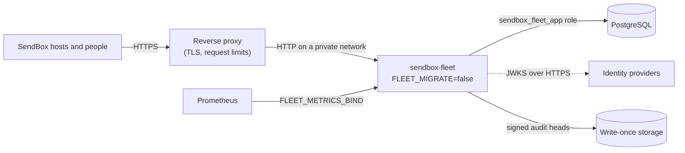

# Deployment

How to run `sendbox-fleet` for a team. [Development](development.md) covers
local runs; this page covers a shared, production-like setup. Every setting
here is an environment variable listed in
[development.md](development.md#configuration).



## Checklist

1. PostgreSQL with the least-privilege roles below. SQLite is for development
   only.
2. A reverse proxy that terminates TLS. The service itself speaks plain HTTP.
3. `FLEET_AUTHORITY_ID` set to the value every host puts under `authority:`.
4. `FLEET_PROFILE_TRUST` naming the operators who sign profiles.
5. `FLEET_OIDC_CONFIG` for people and CI, or admin-issued tokens only.
6. An audit signing key and an anchor directory on storage the database
   administrators cannot rewrite.
7. Metrics on a private address, log shipping from stdout or `FLEET_LOG_DIR`,
   and database backups.

## TLS and the reverse proxy

Bearer tokens must only travel over TLS. Run the service on a private address
(`FLEET_BIND=10.0.0.5:8080`, or the Compose network) behind a proxy such as
nginx, Caddy, Envoy, or a cloud load balancer that:

- terminates TLS 1.2 or later with a certificate hosts trust;
- forwards the `Authorization` header unchanged and adds no identity headers
  (the service ignores `X-Forwarded-User` and similar anyway);
- does not cache responses (token exchange already sends
  `Cache-Control: no-store`);
- limits request rates per client address.

The service rate limits per process: `FLEET_RATE_LIMIT_PER_MINUTE` requests
per authenticated principal, and `FLEET_AUTH_FAILURES_PER_MINUTE` failed
authentications per peer address. Behind a proxy every client shares the
proxy's address, so the failure limit throttles all clients together when one
of them sends bad tokens. Either set `FLEET_AUTH_FAILURES_PER_MINUTE=0` and
rely on the proxy's per-client limit, or raise it well above normal traffic.
`X-Forwarded-For` is not trusted.

Limits are per instance. With several instances, the effective limit is the
per-instance value times the instance count.

## PostgreSQL roles and migrations

[`deploy/postgres/roles.sql`](../deploy/postgres/roles.sql) creates two
roles:

| Role | Can |
| --- | --- |
| `sendbox_fleet_owner` | Owns the schema; runs `sendbox-fleet admin migrate` |
| `sendbox_fleet_app` | Reads and writes operational tables; only `SELECT` and `INSERT` on `audit_events`; only `SELECT` on `_sqlx_migrations`; cannot create, alter, or drop anything |

```sh
psql -v ON_ERROR_STOP=1 -d sendbox_fleet -f deploy/postgres/roles.sql   # as a superuser
psql -d sendbox_fleet -c "ALTER ROLE sendbox_fleet_owner PASSWORD '…'"
psql -d sendbox_fleet -c "ALTER ROLE sendbox_fleet_app PASSWORD '…'"
FLEET_DATABASE_URL=postgres://sendbox_fleet_owner:…@db/sendbox_fleet sendbox-fleet admin migrate
psql -v ON_ERROR_STOP=1 -d sendbox_fleet -f deploy/postgres/roles.sql   # grants on the new tables
```

Then run the service as `sendbox_fleet_app` with `FLEET_MIGRATE=false`. It
refuses to start while a migration is missing and names the fix. Admin
commands run with `FLEET_MIGRATE=false` also check instead of migrating, so
they work with the app role. On upgrade: stop the old version, run
`admin migrate` as the owner, rerun `roles.sql`, then start the new version.

The audit triggers stop the app role and anyone without `ALTER` on the table.
The owner and superusers can still disable them, which is what audit
anchoring is for.

## Identity providers

`FLEET_OIDC_CONFIG` points at a YAML file of trusted issuers. Without it, only
service tokens from `sendbox-fleet admin token issue` authenticate.

```yaml
issuers:
  # People: the principal is `oidc:<verified email>`.
  - issuer: https://accounts.google.com
    audiences: ["123456789-example.apps.googleusercontent.com"]
    kind: user
    principal_claim: email
    principal_prefix: oidc
  # CI: GitHub Actions jobs from one organization, as `github-actions:<repository_id>`.
  - issuer: https://token.actions.githubusercontent.com
    audiences: [sendbox-fleet]
    kind: worker
    principal_claim: repository_id
    principal_prefix: github-actions
    required_claims:
      repository_owner: example
    auto_provision: true
```

| Field | Default | Meaning |
| --- | --- | --- |
| `issuer` | required | Exact `iss`; `https://` (or `http://` on loopback for tests) |
| `audiences` | required | At least one must appear in `aud` |
| `kind` | required | `user` or `worker`; an existing principal of the other kind is refused |
| `principal_claim` | required | Claim that names the principal; string or number |
| `principal_prefix` | required | Unique per issuer, lowercase letters or `-`, not `local-user` |
| `require_email_verified` | true when the claim is `email` | Require `email_verified: true` |
| `auto_provision` | `false` | Create unknown principals on first sign-in, with no roles and no operator flag, audited as `principal.provisioned` |
| `jwks_uri` | from discovery | Skip `/.well-known/openid-configuration` |
| `algorithms` | `RS256`, `ES256`, `EdDSA` | Accepted signature algorithms |
| `required_claims` | none | Claims that must equal these strings |
| `jwks_cache_seconds` | `600` | Key cache lifetime (60 to 86400) |
| `leeway_seconds` | `60` | Clock skew for `exp`, `nbf`, and `iat` (at most 300) |

Keys are fetched over HTTPS with the system CA bundle, without proxies or
redirects, and cached. An unknown key id refreshes the key set at most every
30 seconds. If keys cannot be fetched and none are cached, callers get `503`;
cached keys keep working through an outage.

Keep `auto_provision` off for people unless anyone who can sign in to the
provider may hold a principal; roles still have to be granted per project.
For CI, `required_claims` is what limits which repositories can sign in.

### Signing in from a SendBox host

A JWT from a configured issuer authenticates any `/v1` call directly, but
provider tokens are short-lived. Hosts exchange one for a fleet service token:

```sh
my-idp print-id-token | sendbox governance login
```

`POST /v1/tokens` accepts only identity-provider callers, so a leaked service
token cannot mint more. Exchanged tokens last `FLEET_TOKEN_TTL_SECONDS`
(12 hours) unless the request asks for less or up to
`FLEET_TOKEN_MAX_TTL_SECONDS` (7 days); a principal holds at most 20 live
tokens. `GET /v1/tokens` lists the caller's tokens and
`DELETE /v1/tokens/{id}` revokes one; operators can revoke any token.

In GitHub Actions, request an ID token with the fleet's audience (the job
needs `permissions: id-token: write`), then pass it to `sendbox governance
login --identity-token-file`.

## Audit anchoring

The audit chain detects edits by anyone who cannot recompute every later hash.
A database owner can. Anchors fix that: a signed copy of the chain head, kept
where the database administrators cannot rewrite it.

```sh
sendbox-fleet admin audit keygen --output /etc/sendbox-fleet/audit.key > audit-identity.json
```

The key file is created with mode `0600`; the service refuses to load a key
that group or others can access. Keep it off the database host and out of database backups; publish
`audit-identity.json` to whoever verifies the log.

| Setting | Effect |
| --- | --- |
| `FLEET_AUDIT_SIGNING_KEY` | Enables `GET /v1/audit/head` (operators): the current head, signed |
| `FLEET_AUDIT_ANCHOR_DIR` | Writes `audit-head-<sequence>.json` there at startup and every `FLEET_AUDIT_ANCHOR_INTERVAL_SECONDS` (default 3600) when the chain has advanced |

Point `FLEET_AUDIT_ANCHOR_DIR` at write-once storage, such as an object-store
bucket with object lock mounted into the container, or a directory another
system collects. Anchors are never overwritten. Without a mounted directory,
an external job can call `GET /v1/audit/head` or run
`sendbox-fleet admin audit anchor --output DIR`.

To check the log:

```sh
sendbox-fleet admin audit verify --identity audit-identity.json \
  --anchor anchors/audit-head-00000000000000001234.json …
```

It recomputes the chain and checks that each anchor's signature verifies and
that the database still holds the anchored hash at that sequence. It prints
one JSON line per result and exits non-zero on any failure.

## Metrics

Set `FLEET_METRICS_BIND` (for example `10.0.0.5:9090`) to serve Prometheus
text at `/metrics` on a second listener. It has no authentication, so keep it
on a private network; it is never served on `FLEET_BIND`.

| Metric | Type | Meaning |
| --- | --- | --- |
| `fleet_http_requests_total{class}` | counter | Requests by status class (`2xx`, `4xx`, …) |
| `fleet_http_request_duration_seconds_sum` / `_count` | summary | Request time |
| `fleet_auth_failures_total` | counter | Rejected bearer tokens |
| `fleet_rate_limited_total` | counter | `429` answers |
| `fleet_authorization_decisions_total{decision,reason}` | counter | `/v1/authorize` results by deny reason |
| `fleet_audit_events_total` | counter | Events appended by this process |
| `fleet_audit_sequence` | gauge | Highest audit sequence |

Labels never contain principals, projects, sessions, or tokens. Useful alerts:
a rising `5xx` rate, `fleet_auth_failures_total` spikes, and
`fleet_authorization_decisions_total{reason="authority_unavailable"}`.

## Logs

Logs go to stdout and `FLEET_LOG_DIR`. Files rotate at UTC midnight and when
they reach `FLEET_LOG_MAX_BYTES` (100 MiB), and are pruned after
`FLEET_LOG_RETENTION_DAYS`. In containers, ship stdout and keep the volume
small. See [development.md](development.md#logs).

## Backups and restore

- **PostgreSQL**: `pg_dump --format=custom sendbox_fleet` on a schedule, or
  continuous archiving for point-in-time recovery. Store dumps encrypted and
  away from the database host.
- **SQLite** (development only): `sqlite3 sendbox-fleet.db ".backup copy.db"`
  while the service runs.
- Back up `FLEET_PROFILE_TRUST`, `FLEET_OIDC_CONFIG`, and the audit identity
  with the deployment configuration. Back up the audit signing key separately.

The database holds token digests, not tokens, so a restored backup cannot be
used to sign in. Tokens revoked after the backup become valid again after a
restore, as do principals disabled after it: revoke and disable them again.

After a restore, run `sendbox-fleet admin audit verify` with the newest
anchors. Anchors newer than the backup fail with "the database no longer
holds this sequence", which documents exactly what the restore lost.

## Compose

[`docker-compose.yml`](../docker-compose.yml) passes every setting through
from `.env` and mounts a `fleet-anchors` volume at
`/var/lib/sendbox-fleet/anchors`. Mount the trust file, OIDC file, and audit
key with an override file:

```yaml
# docker-compose.override.yml
services:
  fleet:
    environment:
      FLEET_PROFILE_TRUST: /etc/sendbox-fleet/profile-trust.yaml
      FLEET_OIDC_CONFIG: /etc/sendbox-fleet/oidc.yaml
      FLEET_AUDIT_SIGNING_KEY: /run/sendbox-fleet/audit.key
      FLEET_AUDIT_ANCHOR_DIR: /var/lib/sendbox-fleet/anchors
    volumes:
      - ./config:/etc/sendbox-fleet:ro
      - ./audit-key:/run/sendbox-fleet:ro
```

The service runs as uid 10001, so `./audit-key/audit.key` must be owned by
that uid with mode `0600` or `0400`.
